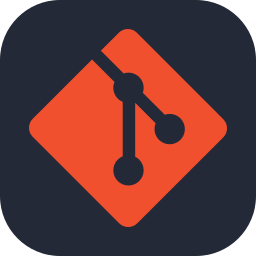
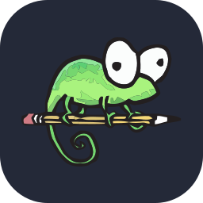
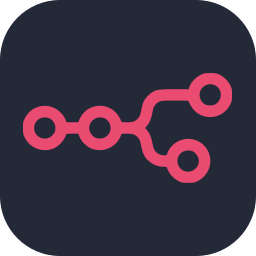
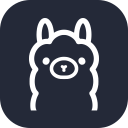

### Olá Mundo! 👋

I'm a Software Engineer, Tech Lead and 🌱 Generative AI enthusiast

```zsh
> composer install
```

```csharp
Microsoft Windows [versão 10.0]
(c) Microsoft Corporation. Todos os direitos reservados.

C:\Users\Arismario Neves>
-------------------------
php -r "copy('https://getcomposer.org/installer', 'composer-setup.php');"
php composer-setup.php
php -r "unlink('composer-setup.php');"
```

<p align="center">
  <a href="https://arismario.dev/"><picture><source media="(prefers-color-scheme: light)" srcset="skill-icons/git-light.svg"></picture></a>
  <a href="https://arismario.dev/"><picture><source media="(prefers-color-scheme: light)" srcset="skill-icons/notepadpp-light.svg"></picture></a>
  <a href="https://arismario.dev/"><picture><source media="(prefers-color-scheme: light)" srcset="skill-icons/php-light.svg"></picture></a>
  <a href="https://arismario.dev/"><picture><source media="(prefers-color-scheme: light)" srcset="skill-icons/mysql-light.svg"></picture></a>
  <a href="https://arismario.dev/"></a>
  <a href="https://arismario.dev/"></a>
  <a href="https://arismario.dev/"><picture><source media="(prefers-color-scheme: light)" srcset="skill-icons/java-light.svg"></picture></a>
  <a href="https://arismario.dev/"><picture><source media="(prefers-color-scheme: light)" srcset="skill-icons/python-light.svg"></picture></a>
  <a href="https://arismario.dev/"><picture><source media="(prefers-color-scheme: light)" srcset="skill-icons/supabase-light.svg"></picture></a>
  <a href="https://arismario.dev/"><picture><source media="(prefers-color-scheme: light)" srcset="skill-icons/n8n-light.svg"></picture></a>
  <a href="https://arismario.dev/"></a>
  <a href="https://arismario.dev/"><picture><source media="(prefers-color-scheme: light)" srcset="skill-icons/bash-light.svg"></picture></a>
  <a href="https://arismario.dev/"><picture><source media="(prefers-color-scheme: light)" srcset="skill-icons/ollama-light.svg"></picture></a>
  <a href="https://arismario.dev/"><picture><source media="(prefers-color-scheme: light)" srcset="skill-icons/gcp-light.svg"></picture></a>
</p>

<picture>
  <source media="(max-width: 600px) and (prefers-color-scheme: light)" srcset="assets/github-stats-compact-light.svg">
  <source media="(max-width: 600px)" srcset="assets/github-stats-compact.svg">
  <source media="(prefers-color-scheme: light)" srcset="assets/github-stats-light.svg">
  
</picture>

[](https://github.com/arismarioneves)
[](https://gist.github.com/arismarioneves)
[](https://github.com/arismarioneves)
